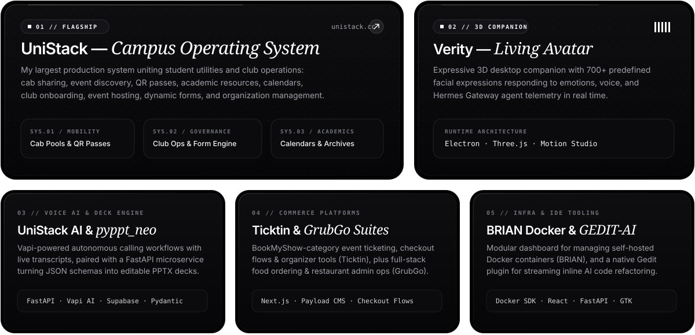

<!-- ==================== ANIMATED CYBER-HUD HERO BANNER ==================== -->

 

<!-- ==================== DYNAMIC TYPING SUBHEADER ==================== -->

<!-- ==================== QUICK ACTION PILLS ==================== -->

  
  &nbsp;
  
  &nbsp;
  
  &nbsp;
  

<!-- ==================== INFINITE SCROLLING TECH MARQUEE ==================== -->

 

## ⚡ Featured Systems & Flagship Products

> Most of my production work lives in **private repositories** powering live platforms and internal pipelines. Below is an overview of the products I've architected, the problems they solve, and my public open-source releases.

  

 

### 🔍 Deep-Dive into the Ecosystem

| System / Product | Category | Stack & Architecture | Highlights & Core Capabilities |
| :--- | :--- | :--- | :--- |
| **[UniStack](https://unistack.cc/)** | `Campus OS` `Live` | `Next.js` `TypeScript` `Supabase` `Tailwind` | Flagship campus platform uniting student utilities & club operations: **cab sharing, event discovery, QR passes, academic calendars, club onboarding, custom forms & org management**. |
| **[Verity Desktop](https://github.com/vaibhav-magoo/verity_desktop)** | `3D AI Companion` `Public` | `Electron` `Three.js` `WebGL` `Hermes` | Expressive 3D desktop companion with **700+ reactive facial expressions**, real-time voice/emotion response, hands-on **3D motion studio**, and optional **Hermes Gateway** agent telemetry. |
| **UniStack AI** | `Voice AI` `Lead Ops` | `Vapi AI` `Supabase` `Next.js` `WebSockets` | Automated lead-generation and voice-agent workflow platform combining bulk **CSV intake, autonomous Vapi phone calling, live streaming transcripts**, and usage telemetry. |
| **Presentation Architect (`pyppt_neo`)** | `AI Document Engine` | `Python` `FastAPI` `Pydantic` `python-pptx` | High-speed presentation generation microservice transforming structured **JSON schemas into editable PowerPoint (`.pptx`) decks** with custom layout engines, themes, and reusable slide blocks. |
| **[BRIAN](https://github.com/vaibhav-magoo/BRIAN)** | `DevOps Control Plane` `Public` | `React` `FastAPI` `Docker SDK` `Python` | Modular full-stack dashboard for managing **self-hosted Docker containers**, inspecting real-time container health, logs, and orchestrating local services. |
| **Ticktin** | `Event Commerce` | `Full-Stack Web` `Payment Gateways` `QR` | BookMyShow-scale event ticketing platform featuring **event discovery, interactive seat/ticket checkout flows, payment completion**, and organizer analytics dashboards. |
| **GrubGo** | `Food Commerce` | `Next.js` `Payload CMS` `TypeScript` | End-to-end food ordering experience paired with a full **restaurant operations & menu admin plane**, optimized for both mobile ordering and desktop kitchen dispatch. |
| **GEDIT-AI** | `Developer Tooling` | `Python` `GTK / Gedit API` `LLM Streaming` | Native **Gedit editor plugin** that brings inline AI code generation, explanation, summarization, bug fixing, and refactoring with **real-time token streaming & insert-at-cursor**. |
| **[Voltis](https://github.com/vaibhav-magoo/Voltis) & [Data Center Tycoon](https://github.com/vaibhav-magoo/data_center_tycoon)** | `R&D Lab` `Public` | `TypeScript` `JavaScript` `Simulation` | Experimental TypeScript application architecture (**Voltis**) and interactive infrastructure simulation engineering (**Data Center Tycoon**). |

 

---

## 🖥️ Engineering Telemetry & Builder Philosophy

  

 

## 🛠️ Technology Arsenal

#### **Languages, Frontend & 3D Interactive**

  

#### **Backend, Databases, AI Workflows & Infrastructure**

  

 

## 📊 Activity Matrix & Contribution Graph

  <picture>
    <source media="(prefers-color-scheme: dark)" srcset="https://github-readme-activity-graph.vercel.app/graph?username=vaibhav-magoo&bg_color=070B14&color=38BDF8&line=A855F7&point=10B981&area=true&hide_border=true&custom_title=Contribution%20%26%20Engineering%20Velocity" />
    
  </picture>

 

<!-- ==================== ANIMATED FOOTER WAVE ==================== -->

  

